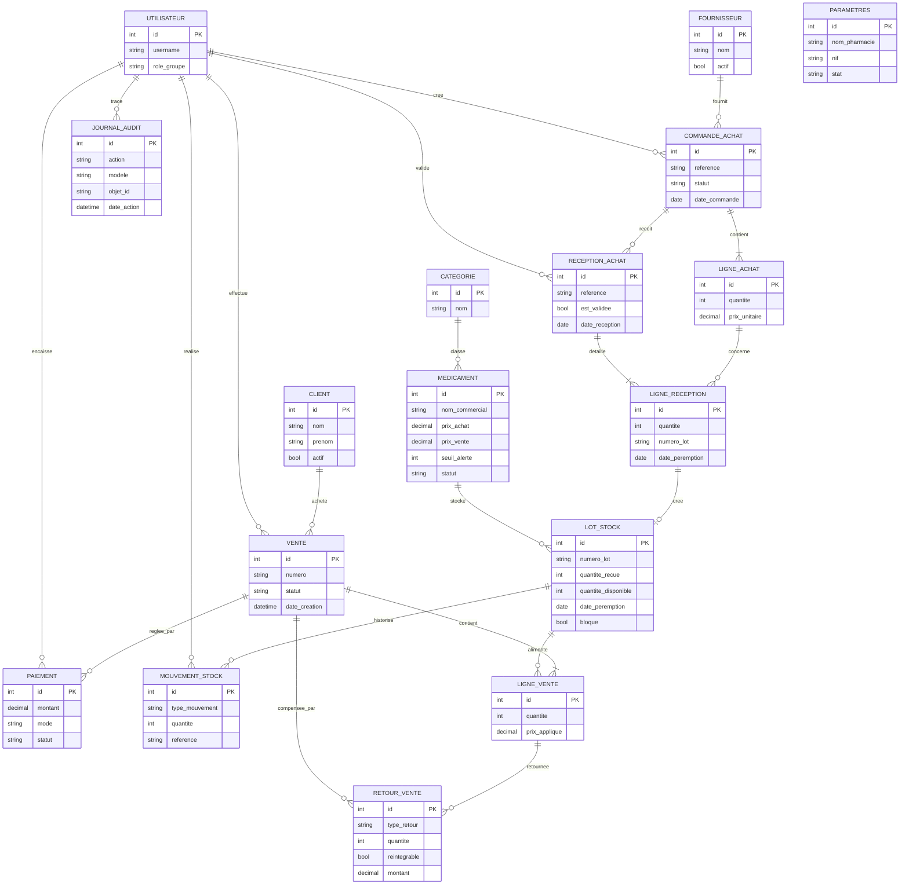
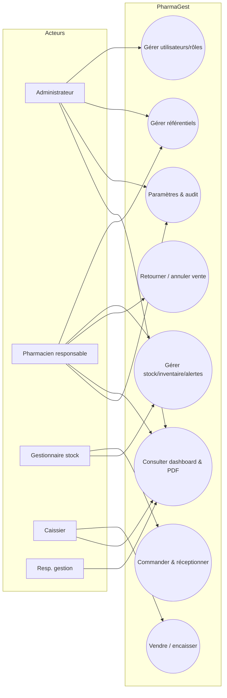
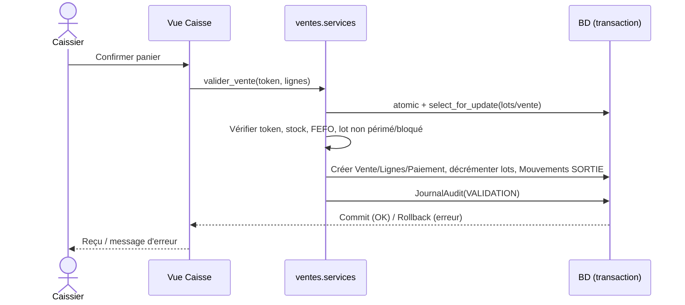

# Dossier de conception - PharmaGest

## 1. Modèle conceptuel de données (MCD, Mermaid ER)

## 2. Modèle logique de données (MLD, relationnel simplifié)
- `utilisateurs_user(id PK, username, email, is_active, ...)` + groupes Django (`auth_group`, `auth_user_groups`)
- `medicaments_categorie(id PK, nom UNIQUE, description)`
- `medicaments_medicament(id PK, categorie_id FK→categorie, nom_commercial, nom_generique, forme, dosage, prix_achat, prix_vente, seuil_alerte, statut, code_barres UNIQUE NULL)`
- `stock_lotstock(id PK, medicament_id FK, reception_ligne_id FK NULL, numero_lot, quantite_recue, quantite_disponible, date_peremption, date_reception, bloque)`
- `stock_mouvementstock(id PK, lot_id FK, auteur_id FK NULL, type_mouvement, quantite, reference, commentaire, date_mouvement)`
- `fournisseurs_fournisseur(id PK, nom, telephone, contact, email, adresse, ville, actif)`
- `achats_commandeachat(id PK, fournisseur_id FK, cree_par_id FK, reference UNIQUE, statut, date_commande, notes)`
- `achats_ligneachat(id PK, commande_id FK, medicament_id FK, quantite, prix_unitaire)`
- `achats_receptionachat(id PK, commande_id FK, validee_par_id FK, reference UNIQUE, est_validee, date_reception, commentaire)`
- `achats_lignereception(id PK, reception_id FK, ligne_achat_id FK, quantite, numero_lot, date_peremption)`
- `clients_client(id PK, nom, prenom, telephone, email, adresse, date_naissance, actif)`
- `ventes_vente(id PK, client_id FK NULL, caissier_id FK, numero UNIQUE, statut, date_creation)`
- `ventes_lignevente(id PK, vente_id FK, lot_id FK, quantite, prix_applique)`
- `ventes_paiement(id PK, vente_id FK, caissier_id FK, montant, mode, statut, reference, date_paiement)`
- `ventes_retourvente(id PK, vente_id FK, ligne_vente_id FK NULL, lot_id FK NULL, auteur_id FK, type_retour, quantite, reintegrable, montant, motif)`
- `rapports_journalaudit(id PK, utilisateur_id FK NULL, action, modele, objet_id, description, adresse_ip, date_action)`
- `rapports_parametres(id PK singleton, nom_pharmacie, adresse, telephone, email, nif, stat, mentions_legales)`

## 3. UML - cas d'utilisation (Mermaid)

## 4. UML - séquence (vente validée, simplifié)

## 5. Règles de gestion clés
- RG04 : commande ≠ stock ; entrée stock uniquement à réception validée.
- RG05 : anti double validation réception (verrouillage/transaction).
- RG06-RG08/RG12 : vente atomique, re-vérification serveur, lot valide (non périmé/bloqué), qté ≤ stock, prix appliqué figé.
- FEFO : allocation par date de péremption croissante.
- Retours/annulations : compensatoires, sans suppression de la vente d'origine, audit.
- Traçabilité : `JournalAudit` sur opérations sensibles (auth, CRUD sensibles, validations, mouvements/ajustements, PDFs selon vues).
